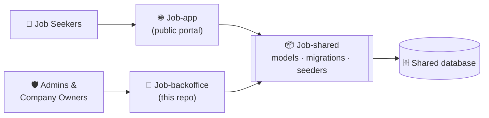

<div align="center">

# 🏢 JobBoard Backoffice

**The administration and company-management console of the JobBoard platform.**

Manage companies, vacancies, categories, users and AI-scored job applications from a single, role-aware dashboard.

<p>
  
  
  
  
  
  
</p>

</div>

---

## 📑 Table of Contents

- [Overview](#-overview)
- [Ecosystem](#-ecosystem)
- [Features](#-features)
- [Roles & Permissions](#-roles--permissions)
- [Tech Stack](#-tech-stack)
- [Getting Started](#-getting-started)
- [Demo Accounts](#-demo-accounts)
- [Project Structure](#-project-structure)
- [Routes Overview](#-routes-overview)
- [Testing & Code Style](#-testing--code-style)
- [Roadmap](#-roadmap)
- [License](#-license)

---

## 🔎 Overview

**JobBoard Backoffice** is the internal-facing Laravel application of the JobBoard platform. It gives **administrators** full control over the platform and gives **company owners** a focused workspace for their own company, vacancies and incoming applications.

Applications submitted by job seekers in the public [JobBoard App](https://github.com/AbdoNasser23/Job-app) arrive here already **analysed by AI** (a relevance score from 0 to 100 plus written feedback), so recruiters can sort and review candidates faster.

Both applications share the same models and database schema through the [`job/shared`](https://github.com/AbdoNasser23/Job-shared) Composer package, which guarantees the two apps always agree on the data.

## 🧩 Ecosystem



| Repository | Purpose |
|---|---|
| [**Job-app**](https://github.com/AbdoNasser23/Job-app) | Public portal where job seekers browse vacancies and apply with their CV |
| [**Job-backoffice**](https://github.com/AbdoNasser23/Job-backoffice) | Admin & company-owner console *(you are here)* |
| [**Job-shared**](https://github.com/AbdoNasser23/Job-shared) | Shared Eloquent models, migrations and seeders |

## ✨ Features

### 📊 Analytics dashboard
- **Active job seekers** – users with a login in the last 30 days (admin view).
- **Total active vacancies** and **total applications** – platform-wide for admins, scoped to their own company for owners.
- **Top 5 most-applied vacancies.**
- **Top 5 conversion rates** – applications ÷ views per vacancy, fed by the unique-view tracking in Job-app.

### 💼 Vacancy management
- Full CRUD with validation (title, description, location, salary, category, company).
- Employment types: `full_time`, `contract`, `remote`, `hybrid`.
- Per-vacancy detail page with its applications.

### 🏭 Company management
- Create a company and either **attach an existing owner** or **create a new owner account** in the same step (wrapped in a database transaction, with an email-verification notification sent to new owners).
- Industry classification, address and website.

### 🗂️ Categories
- Admin-managed job categories used to classify vacancies.

### 📄 Application review
- Browse applications with the candidate's **AI score** and **AI feedback**.
- Move an application through `pending → approved / rejected`.
- Access the submitted CV.

### 👥 User management
- Admin-only user list, edit and archive.
- **Cascading archive:** archiving a company owner also archives their company and its vacancies; **restoring** the user restores exactly what was archived with them (tracked through the `archived_with_user` and `archived_with_company` flags).

### 🗃️ Archive-first data handling
- Every resource uses **soft deletes** with dedicated *Archived* pages, **restore** actions and explicit **permanent delete** where allowed.

## 🔐 Roles & Permissions

Access is enforced in two layers: a `role` middleware on the route group (only `admin` and `company_owner` can enter) and Laravel **Policies** on every resource. Job seekers are rejected at login.

| Capability | Admin | Company Owner |
|---|:---:|:---:|
| View dashboard analytics | ✅ Platform-wide | ✅ Own company only |
| Manage users | ✅ | ❌ |
| Create companies | ✅ | ❌ |
| View / edit / archive companies | ✅ All | ✅ Own only |
| Manage categories | ✅ | ❌ (view only) |
| Manage vacancies | ✅ All | ✅ Own company only |
| View applications | ✅ All | ✅ Own vacancies only |
| Update application status | ❌ | ✅ Own vacancies only |
| Archive / restore / delete applications | ✅ | ✅ Own vacancies only |

## 🛠️ Tech Stack

| Layer | Technology |
|---|---|
| Language | PHP 8.3+ |
| Framework | Laravel 13 |
| Views | Blade, Alpine.js |
| Styling | Tailwind CSS 3 + `@tailwindcss/forms` |
| Build tooling | Vite 8 |
| Authentication | Laravel Breeze |
| Authorization | Gates, Policies, custom `RoleMiddleware` |
| Testing | Pest 5 |
| Code style | Laravel Pint |
| Database | MySQL / MariaDB (recommended) or SQLite |
| Shared code | [`job/shared`](https://github.com/AbdoNasser23/Job-shared) |

## 🚀 Getting Started

### Prerequisites

- PHP **8.3+** with the usual Laravel extensions
- [Composer](https://getcomposer.org/) 2+
- Node.js 20.19+ and npm
- MySQL / MariaDB (or SQLite for a quick start)
- Git

### 1. Clone and install

```bash
git clone https://github.com/AbdoNasser23/Job-backoffice.git
cd Job-backoffice

composer install
npm install
```

`job/shared` is pulled automatically from GitHub through the VCS repository declared in `composer.json`, so you do **not** need to clone it manually.

### 2. Configure the environment

```bash
cp .env.example .env
php artisan key:generate
```

The default `.env.example` uses SQLite. For MySQL / MariaDB, update:

```env
DB_CONNECTION=mysql
DB_HOST=127.0.0.1
DB_PORT=3306
DB_DATABASE=jobboard
DB_USERNAME=root
DB_PASSWORD=
```

> ⚠️ **Job-app and Job-backoffice must point to the same database.** If you use SQLite, set `DB_DATABASE` to the same absolute file path in both projects.

### 3. Migrate and seed

The migrations ship with the shared package and are loaded automatically.

```bash
php artisan migrate
php artisan db:seed
```

> Run the migrations and the seeder **once** for the shared database, from either application.

### 4. Run the app

```bash
npm run build        # or `npm run dev` for hot reloading
php artisan serve
```

Open **http://127.0.0.1:8000** and sign in with a [demo account](#-demo-accounts).

> 💡 If you run Job-app at the same time, start one of them on another port: `php artisan serve --port=8001`.

## 🔑 Demo Accounts

After seeding, the following accounts are available:

| Role | Email | Password |
|---|---|---|
| Admin | `admin@admin.com` | `123456789` |
| Job Seeker *(Job-app only)* | `job@seeker.com` | `123456789` |

The seeder also generates one **company owner** per seeded company with a random email (all with password `123456789`). Look them up in the **Users** page as an admin.

> 🔒 These credentials are for local development only. Change or remove them before any deployment.

## 🗺️ Project Structure

```text
Job-backoffice/
├── app/
│   ├── Http/
│   │   ├── Controllers/        # Company, Vacancy, Application, Category, User, Dashboard + Auth
│   │   ├── Middleware/         # RoleMiddleware (role:admin,company_owner)
│   │   └── Requests/           # Form Requests with validation rules
│   ├── Policies/               # Application, Category, Company, User, Vacancy
│   ├── Services/
│   │   └── AnalyticsService.php  # Dashboard metrics (role-scoped)
│   └── View/Components/
├── resources/
│   ├── views/                  # Blade views per resource (index/create/edit/show/archived)
│   ├── css/  js/
├── routes/
│   ├── web.php                 # Protected backoffice routes
│   └── auth.php                # Authentication routes
├── tests/                      # Pest feature & unit tests
└── composer.json               # Requires job/shared
```

> Models, migrations and seeders live in the **Job-shared** package, not in this repository.

## 🧭 Routes Overview

Every resource follows the same pattern, shown here for vacancies:

| Method | URI | Action |
|---|---|---|
| `GET` | `/vacancies` | List |
| `GET` / `POST` | `/vacancies/create` · `/vacancies` | Create |
| `GET` | `/vacancies/{vacancy}` | Show |
| `GET` / `PUT` | `/vacancies/{vacancy}/edit` · `/vacancies/{vacancy}` | Edit |
| `DELETE` | `/vacancies/{vacancy}` | Archive (soft delete) |
| `GET` | `/vacancies/archived` | Archived list |
| `PATCH` | `/vacancies/{vacancy}/restore` | Restore |
| `DELETE` | `/vacancies/{vacancy}/archived` | Permanent delete |

The same structure applies to `applications`, `categories` and `companies`; `users` supports archive and restore only. The dashboard lives at `/`.

## 🧪 Testing & Code Style

```bash
composer test            # clears config cache, then runs the Pest suite
./vendor/bin/pint        # format the code with Laravel Pint
```

## 🛣️ Roadmap

- [ ] Export applications and analytics (CSV / PDF)
- [ ] Advanced filtering and bulk actions on applications
- [ ] Email notifications to candidates on status changes
- [ ] Charts and time-range filters on the dashboard
- [ ] Audit log for administrative actions

## 📄 License

Released under the [MIT License](https://opensource.org/licenses/MIT).

---

<div align="center">

**JobBoard Backoffice** — Manage. Monitor. Organize.

Built by [AbdoNasser23](https://github.com/AbdoNasser23)

</div>
